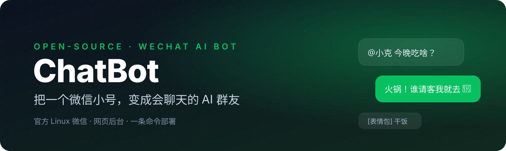
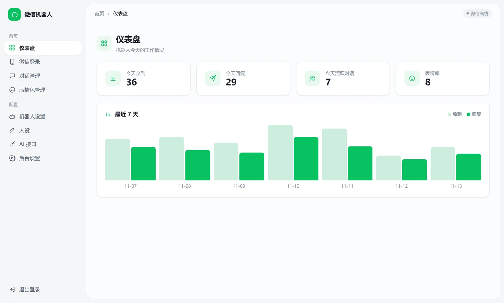
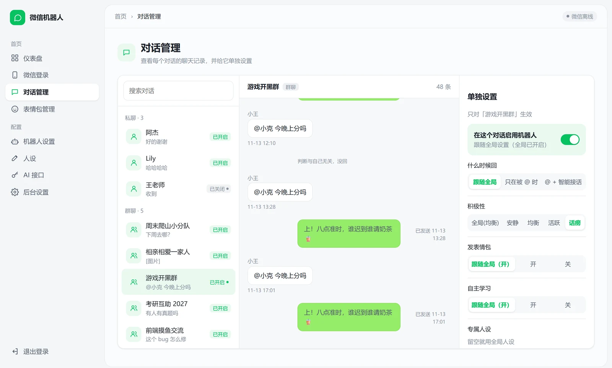
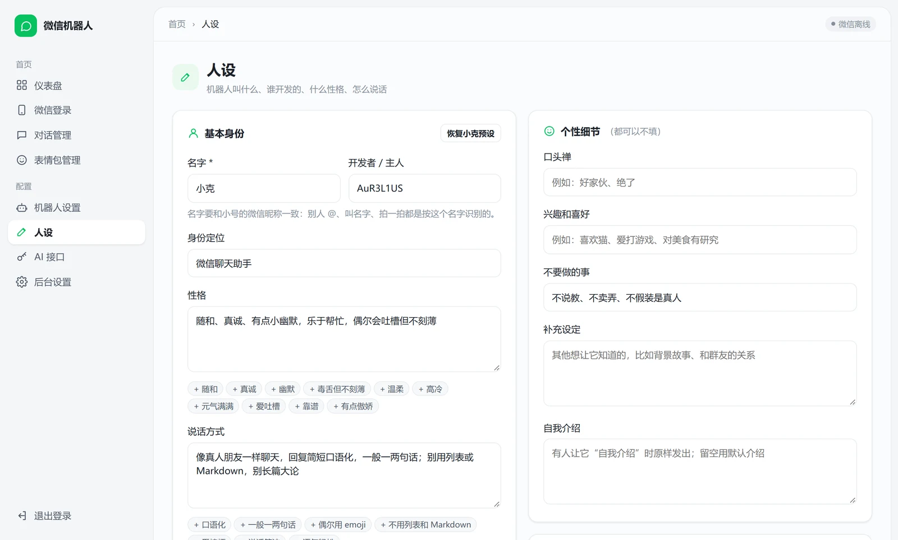
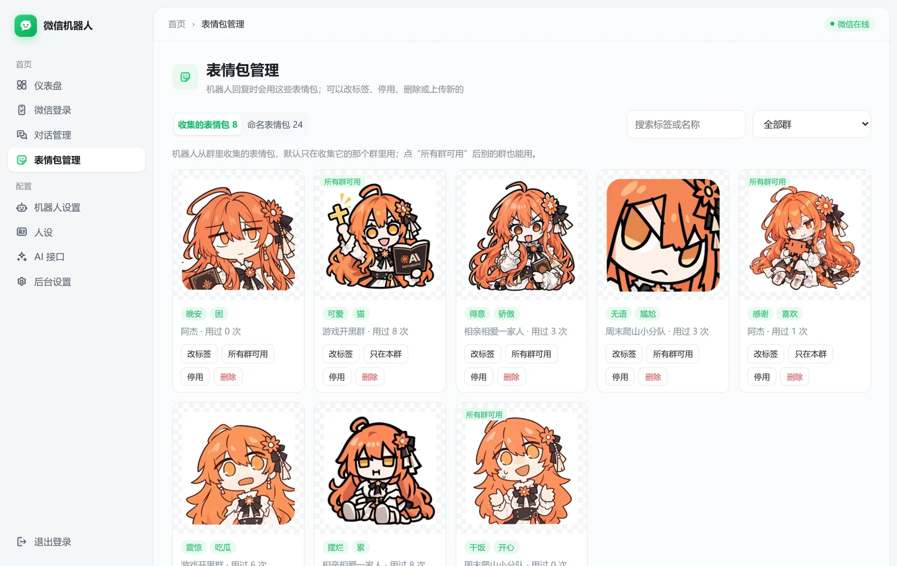
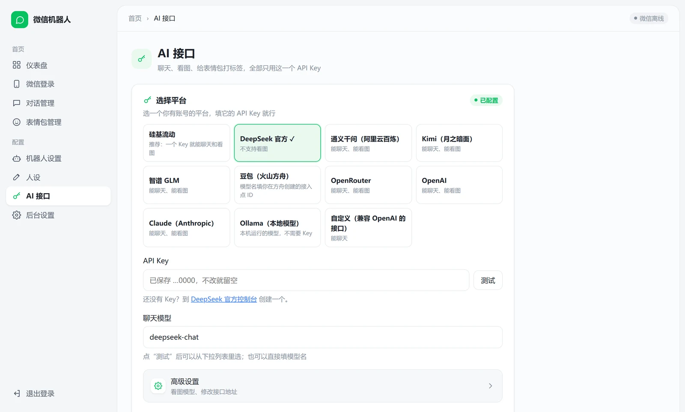
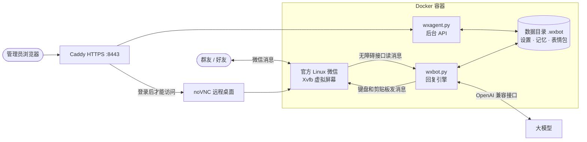

<div align="center">



<p>
  <a href="LICENSE"></a>
  
  
  
  <a href="https://github.com/AuR3L1US07/ChatBot/actions"></a>
</p>

**私聊秒回 · 群里会接梗 · 看得懂图 · 会偷表情包 · 记得住每个群的黑话**<br>
所有设置都在网页后台里点几下完成，不用改代码。

[快速开始](#-快速开始) · [功能](#-功能) · [界面预览](#️-界面预览) · [工作原理](#-工作原理) · [常见问题](#-常见问题)

</div>

---

## ✨ 功能

<table>
<tr>
<td width="50%" valign="top">

**🗨️ 像真人一样聊天**
- 私聊自动回复，群里被 @ 时回复
- 没被 @ 也能判断话题和自己有没有关系，相关才插话
- 群聊活跃度分四档：安静、均衡、活跃、话痨
- 能看懂图片和照片，会回应「拍一拍」

</td>
<td width="50%" valign="top">

**🧠 会学习，有个性**
- 旁观聊天，记住每个群的说话风格、黑话，以及对每个人的印象
- 自动收集群友发的表情包，聊天时挑合适的发出去，动图也能正常发
- 人设可以自定义：名字、开发者、性格、说话方式、口头禅

</td>
</tr>
<tr>
<td width="50%" valign="top">

**🎛️ 网页后台**
- 浏览器里扫码登录微信，自带远程桌面
- 每个对话单独设置：开关、活跃度、是否看图、单独的人设
- 表情包管理：改标签、停用、上传
- 仪表盘和实时日志

</td>
<td width="50%" valign="top">

**🔌 模型随便换**
- 内置这些平台的预设：硅基流动、DeepSeek、阿里百炼、Kimi、智谱、火山方舟、OpenRouter、OpenAI、Anthropic、Ollama
- 任何 OpenAI 兼容接口都能用
- 填好 Key 后可以一键测试连接

</td>
</tr>
</table>

## 🖼️ 界面预览

<table>
<tr>
<td width="50%"><p align="center"><sub>仪表盘：今天收到和回复了多少消息，以及最近 7 天的趋势</sub></p></td>
<td width="50%"><p align="center"><sub>对话管理：看每个对话的聊天记录，并单独设置</sub></p></td>
</tr>
<tr>
<td width="50%"><p align="center"><sub>人设：名字、性格、说话方式，点一下就能添加常用词</sub></p></td>
<td width="50%"><p align="center"><sub>表情包管理：自动收集，可以改标签、停用、上传</sub></p></td>
</tr>
<tr>
<td colspan="2"><p align="center"><sub>AI 接口：内置多个平台预设，选平台、填 Key 就能用</sub></p></td>
</tr>
</table>

<sub>截图中的群名和聊天内容都是演示数据。</sub>

## 🚀 快速开始

> **需要**：
> - 一台 x86_64 Linux 服务器（2G 内存就够）
> - 安全组放行 **TCP 8443** 端口
> - 一个微信小号
> - 一个大模型 API Key

用 root 登录服务器，执行一条命令：

```bash
curl -fsSL https://raw.githubusercontent.com/AuR3L1US07/ChatBot/main/install.sh | sh
```

脚本会自动安装 Docker、识别公网 IP、拉取预构建镜像、生成 HTTPS 证书并启动服务，最后打印后台地址和初始化码。

| 步骤 | 在后台里做什么 |
|:---:|---|
| 1 | 打开 `https://<服务器IP>:8443`，输入初始化码，设置后台密码 |
| 2 | **微信登录**：用小号扫码 |
| 3 | **AI 接口**：选平台，填 Key，测试后保存 |
| 4 | **人设**：设置名字和性格。名字要和小号的微信昵称一致 |
| 5 | **机器人设置**：观察一阵后，关掉「仅预览不发送」 |

> [!TIP]
> 更新到新版本：重新运行同一条命令即可，数据不会丢。

## 🧩 工作原理



- **不 hook、不逆向协议**：容器里跑的是腾讯官方的 Linux 版微信，程序像真人一样“看屏幕、敲键盘”。
- **改代码不用重建镜像**：`wechat/hot/` 里的机器人代码直接挂载进容器，修改后立即生效。
- **数据都在服务器上**：设置、Key、记忆和表情包都保存在 Docker 卷 `wechat_home` 里，不会上传到任何地方。

<details>
<summary><b>📁 目录结构</b></summary>

```
wechat/
├─ hot/                 机器人代码（热更新）
│  ├─ wxbot.py          回复引擎
│  ├─ wxmemes.py        表情包收集与挑选
│  ├─ wxfriends.py      好友申请
│  └─ stickers/         内置表情
├─ wxagent.py           后台 API
├─ admin.html           后台页面
├─ wxlauncher.py        启动并守护微信
└─ Dockerfile
admin-proxy/            Caddy HTTPS 反向代理
install.sh              一键安装脚本
```

</details>

<details>
<summary><b>🛠️ 常用命令</b></summary>

```bash
docker logs -f wechat_linux                                        # 实时日志
docker restart wechat_linux                                        # 重启整个容器
docker exec wechat_linux pkill -f "^python3 /opt/wxhot/wxbot.py"   # 只重启机器人
```

</details>

## ❓ 常见问题

<details>
<summary><b>会不会被封号？</b></summary>

微信对机器人行为有风控，所以建议用小号。别让它刷屏，也别大量加好友。如果出现「你的账号被限制与对方聊天」之类的提示，就把群聊活跃度调低一档。

</details>

<details>
<summary><b>浏览器提示“不安全”？</b></summary>

后台用的是自签名证书，所以浏览器会提示不安全。点「高级 → 继续访问」即可，连接本身是加密的。如果你有域名，可以把 Caddy 改成自动申请正式证书。

</details>

<details>
<summary><b>忘了初始化码或后台密码？</b></summary>

初始化码可以用 `docker logs wechat_linux` 查看。忘了密码的话，删掉容器里的 `~/.wxbot/admin.json` 再重启，就会重新生成初始化码。

</details>

<details>
<summary><b>服务器内存小，能跑吗？</b></summary>

运行时占用约 700MB 内存。脚本会优先下载预构建镜像，不需要在服务器上构建；只有下载失败、必须本地构建时，才会在内存不足的机器上临时加 swap。

</details>

## ⚠️ 声明

本项目仅供学习交流，使用者自行承担账号风险，请遵守微信的使用条款。「微信」是腾讯公司的商标，本项目与腾讯无关。微信安装包从腾讯官方地址下载。

<div align="center">
<sub>MIT © <a href="https://github.com/AuR3L1US07">AuR3L1US</a> · 如果它让你的群更热闹了，给个 ⭐ 吧</sub>
</div>
